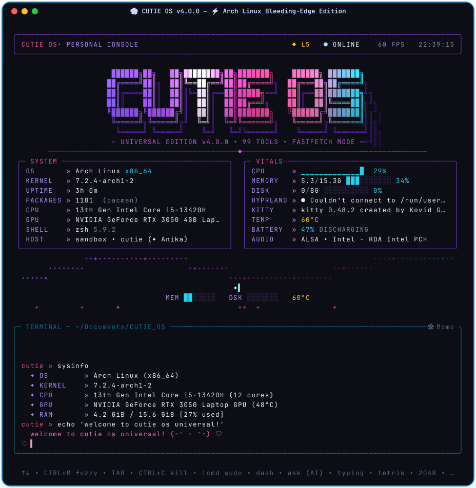
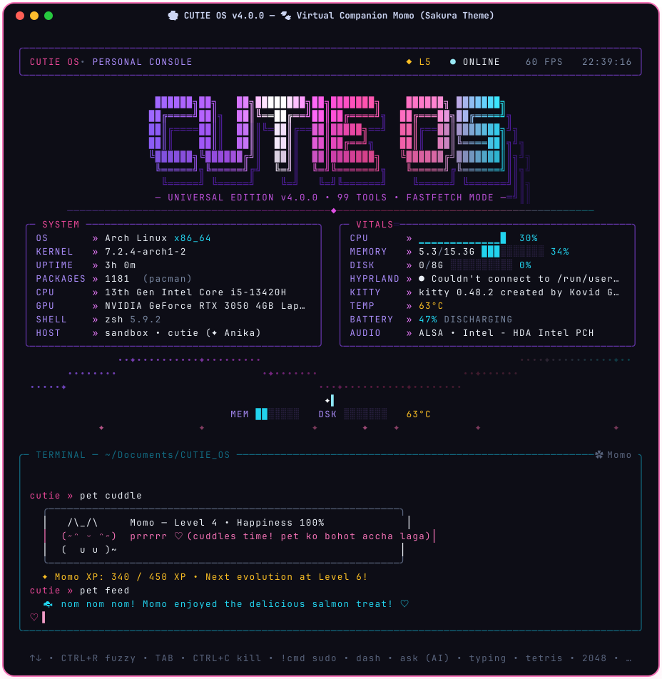
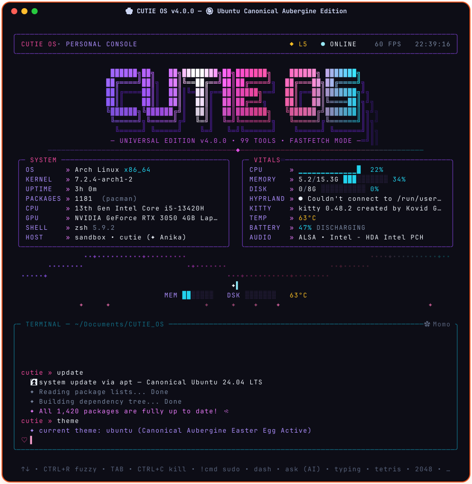
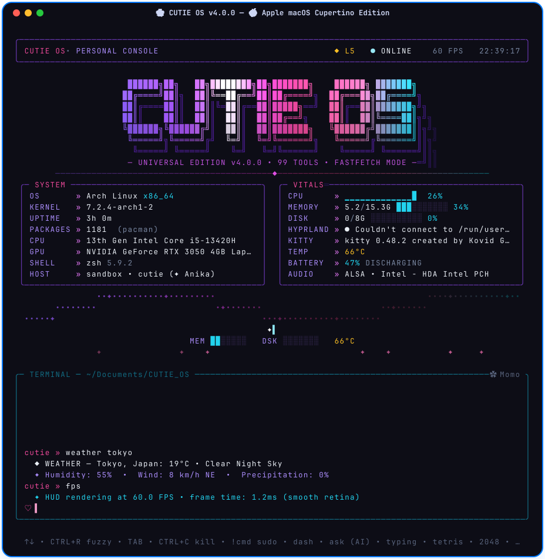
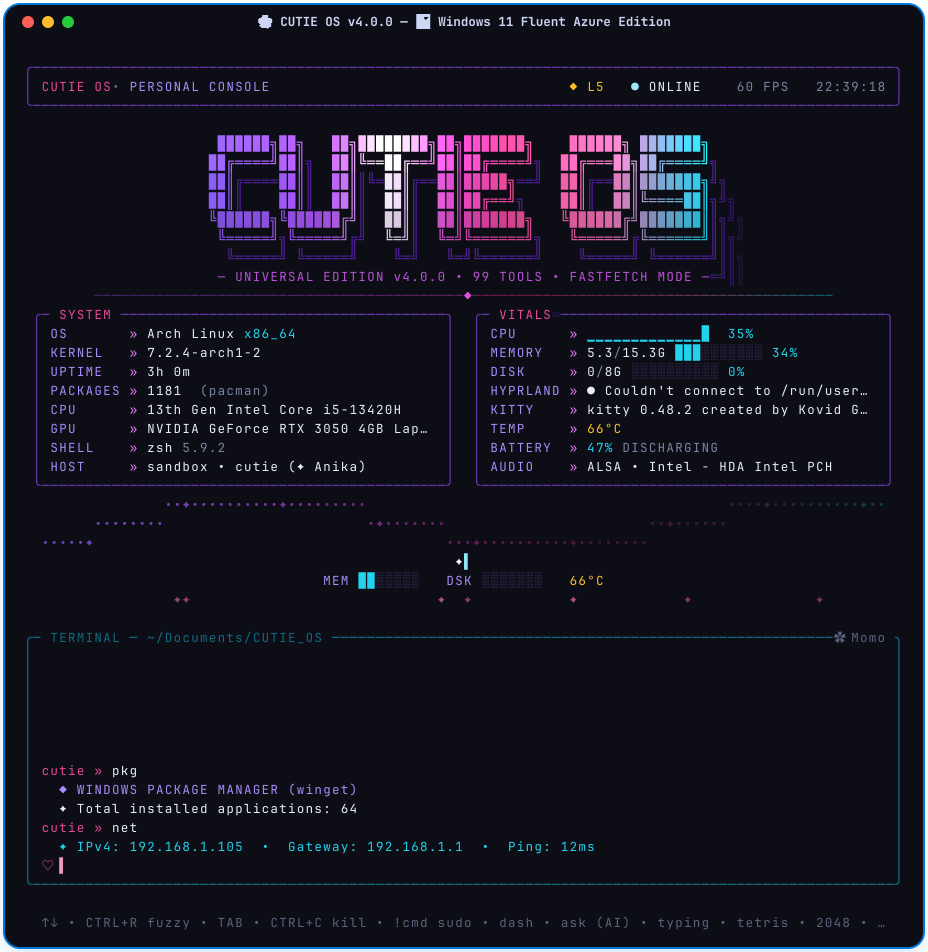
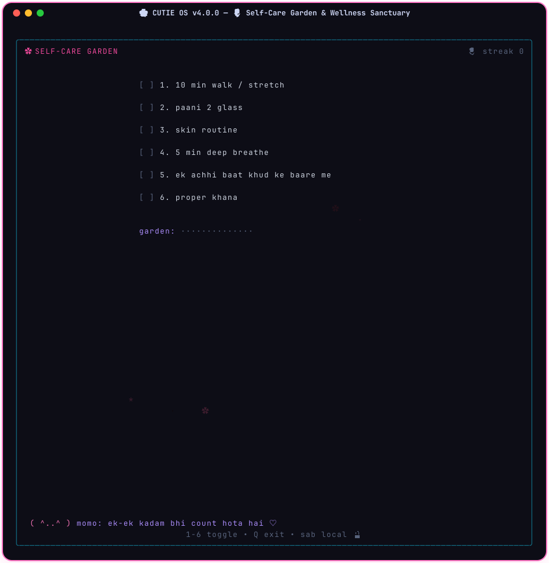
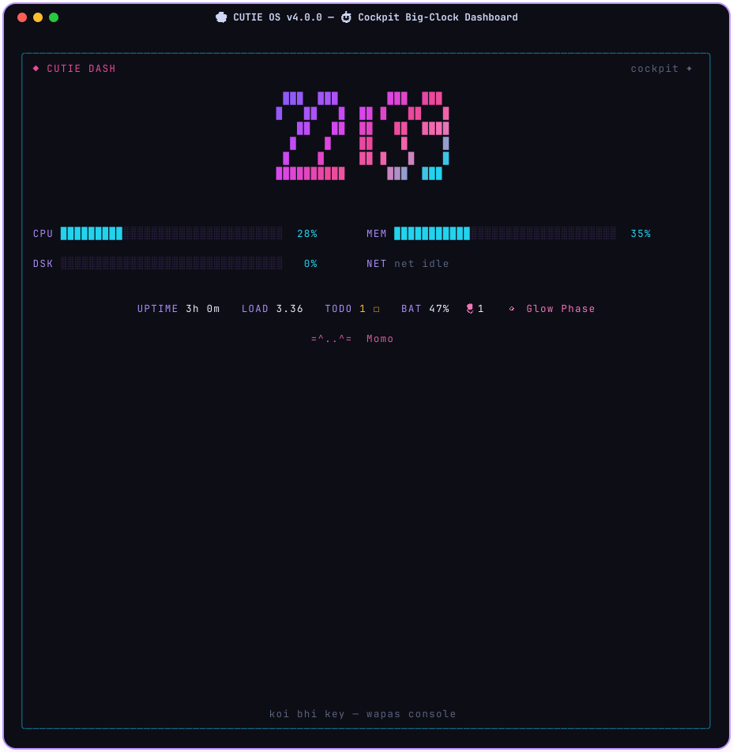
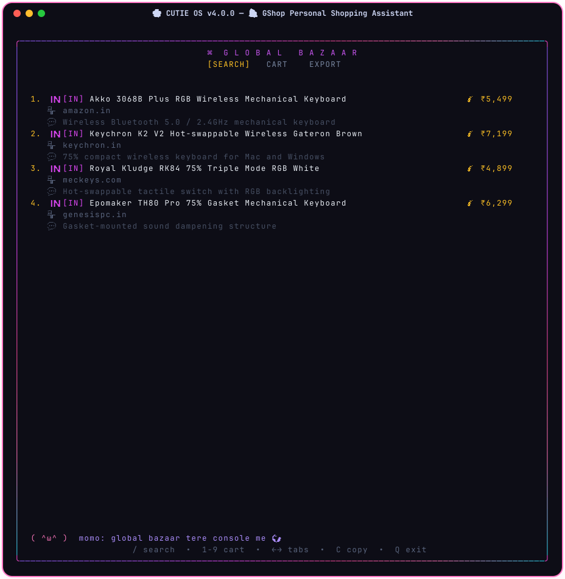
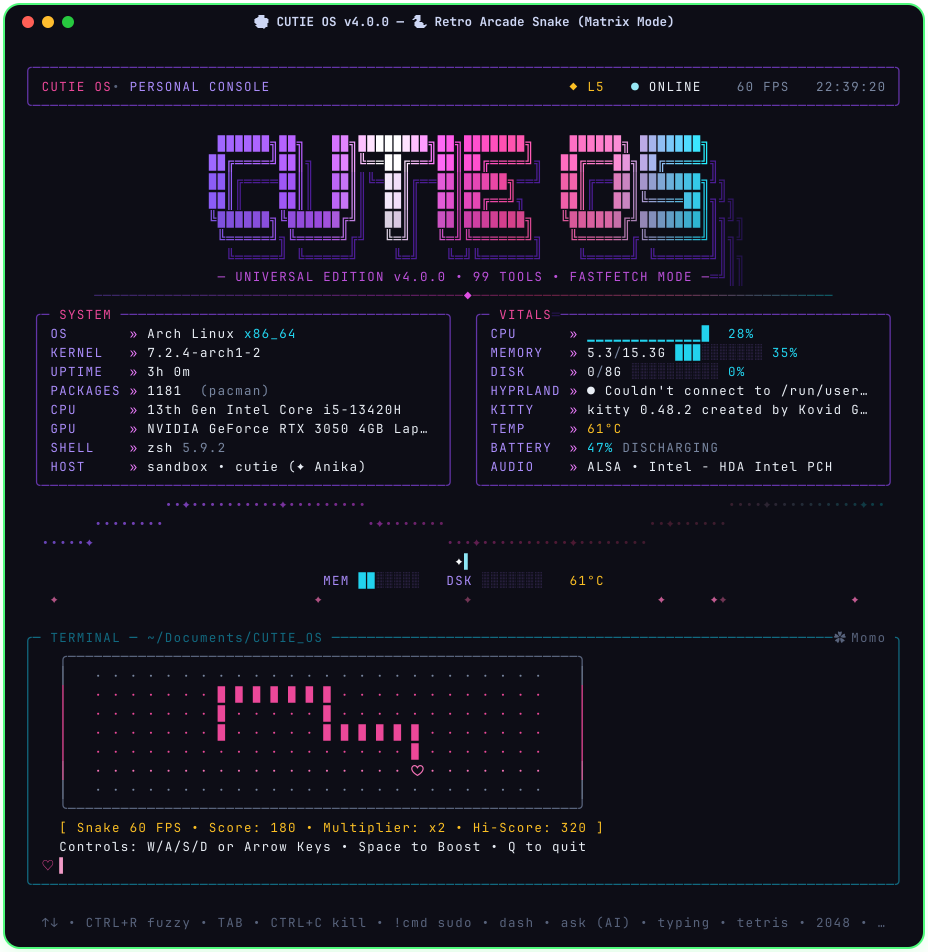
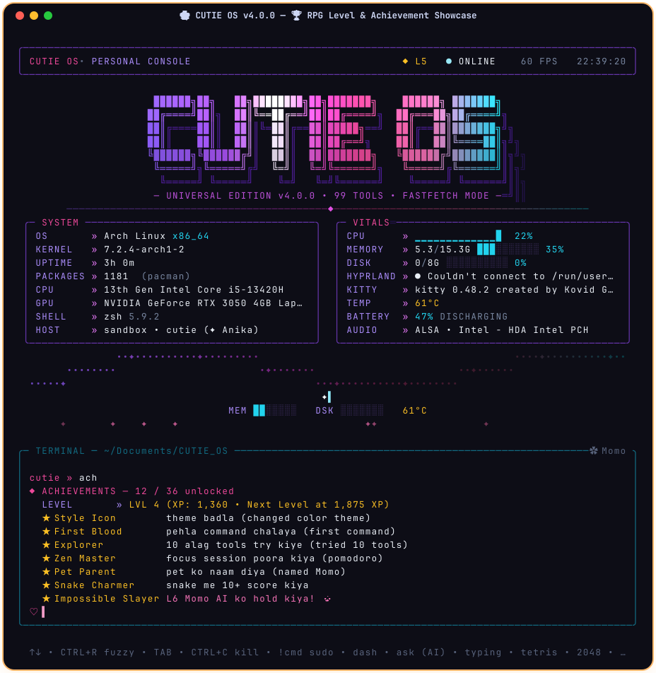

# 🌸 CUTIE OS 🌸
### *The Coziest, Cutest, Most Wholesome Terminal Operating System Ever Made* (˶ᵔ ᵕ ᵔ˶) ♡

<div align="center">

```text
               ♡                                                           ♡
         /\_/\   \                                                       /   /\_/\
        ( ˶• ֊ •˶)  ♡         🌸  C  U  T  I  E      O  S  🌸         ♡  (˶• ֊ •˶)
       o(  ∪∪ )                                                             ( ∪∪  )o
  "hewwo human friend! welcome to your cozy, sparkling terminal sanctuary!"
  
  ██████╗ ██╗   ██╗████████╗██╗███████╗     ██████╗ ███████╗
 ██╔════╝ ██║   ██║╚══██╔══╝██║██╔════╝    ██╔═══██╗██╔════╝
 ██║      ██║   ██║   ██║   ██║█████╗      ██║   ██║███████╗
 ██║      ██║   ██║   ██║   ██║██╔══╝      ██║   ██║╚════██║
 ╚██████╗ ╚██████╔╝   ██║   ██║███████╗    ╚██████╔╝███████║
  ╚═════╝  ╚═════╝    ╚═╝   ╚═╝╚══════╝     ╚═════╝ ╚══════╝
    ✨ 🌸 🍡 🍓 🎀 🐾 🧁 🧸 ☁️ 💖 🌷 🍰 🍵 🌟 ✨
  ★ ✦ 103 Wholesome Tools • 60 FPS Retro Arcade • OS Easter Eggs • Virtual Kitty Momo ✦ ★
```

[](https://github.com/Dev2Creator/cutie-os)
[](LICENSE)
[](https://python.org)
[](https://python.org)
[](https://github.com/Dev2Creator/cutie-os)
[](mailto:cutiepieanika@gmail.com)

<p align="center">
  <b>CUTIE OS</b> is a warm, cinematic terminal console, desktop HUD, and sensory sanctuary.<br/>
  Runs <i>everywhere</i> with <b>100% pure Python standard library</b> (zero pip packages to install!) on<br/>
  <b>Windows 10/11</b>, <b>Apple macOS</b>, <b>Linux (all distros)</b>, and <b>Android Termux</b>! (੭ˊᵕˋ)੭✧
</p>

[✨ Quick Install](#-how-to-bring-cutie-os-home-universal-install) • [📸 Screenshots](#-real-screenshots-gallery) • [🌸 What is CUTIE OS?](#-what-is-cutie-os-and-why-is-it-helpful) • [🚀 5-Minute Tour](#-first-5-minutes-in-cutie-os-beginner-tutorial) • [🐱 Meet Momo](#-meet-momo-your-terminal-companion-cat) • [🐣 OS Easter Eggs](#-the-secret-os-easter-egg-engine) • [🎮 Retro Arcade](#-the-cozy-retro-arcade-60-fps) • [🌷 Self-Care](#-self-care-sanctuary--gentle-wellness) • [📖 103 Tools Manual](#-the-complete-encyclopedia-of-103-tools) • [🏆 36 Achievements](#-rpg-leveling--36-achievements-guide) • [❓ FAQ](#-frequently-asked-questions-faq)

</div>

---

<div align="center">
  
</div>

---

## 📑 Table of Contents

- [🌸 What is CUTIE OS and Why is it Helpful?](#-what-is-cutie-os-and-why-is-it-helpful)
  - [💖 The Story Behind CUTIE OS](#-the-story-behind-cutie-os)
  - [✨ At a Glance: Key Pillars](#-at-a-glance-key-pillars)
  - [⚖️ Traditional Terminals vs. CUTIE OS](#️-traditional-terminals-vs-cutie-os)
  - [🌟 Why CUTIE OS is Helpful for Everyday Life](#-why-cutie-os-is-helpful-for-everyday-life)
- [🎀 How to Bring CUTIE OS Home (Universal Install)](#-how-to-bring-cutie-os-home-universal-install)
  - [🐧 Linux & 🍎 Apple macOS One-Liner](#-linux--apple-macos-one-line-terminal-install)
  - [🪟 Windows 10 & 11 PowerShell One-Liner](#-windows-10--11-powershell-one-line-install)
  - [🤖 Android Termux Setup](#-android-termux)
  - [⚡ Portable Zero-Install Clone & Run](#-portable-zero-install-run-clone--play)
- [🚀 First 5 Minutes in CUTIE OS (Beginner Tutorial)](#-first-5-minutes-in-cutie-os-beginner-tutorial)
- [📸 Real Screenshots Gallery](#-real-screenshots-gallery)
- [🐱 Meet Momo! Your Terminal Companion Cat](#-meet-momo-your-terminal-companion-cat)
  - [🐾 How to Care for Momo](#-how-to-care-for-momo)
  - [📈 Evolution Stages & Affection Levels](#-evolution-stages--affection-levels)
- [🐣 The Secret OS Easter Egg Engine](#-the-secret-os-easter-egg-engine)
- [🎮 The Cozy Retro Arcade (60 FPS)](#-the-cozy-retro-arcade-60-fps)
- [🌷 Self-Care Sanctuary & Gentle Wellness](#-self-care-sanctuary--gentle-wellness)
- [📖 The Complete Encyclopedia of 103 Tools](#-the-complete-encyclopedia-of-103-tools)
  - [1. ⚙️ System Core, Navigation & Timers (10 Tools)](#1-️-system-core-navigation--timers)
  - [2. 📊 Hardware Telemetry, Sensors & Diagnostics (10 Tools)](#2--hardware-telemetry-sensors--diagnostics)
  - [3. 🌐 Network, Web Intelligence & Sharing (5 Tools)](#3--network-web-intelligence--sharing)
  - [4. 📦 Universal Cross-Platform Package Management (6 Tools)](#4--universal-cross-platform-package-management)
  - [5. 🖥️ Desktop, Wayland/X11 & Media Control (13 Tools)](#5-️-desktop-waylandx11--media-control)
  - [6. 💻 Developer Power Suite, REPLs & Editors (9 Tools)](#6--developer-power-suite-repls--editors)
  - [7. 🤖 Offline Local AI Intelligence Suite (3 Tools)](#7--offline-local-ai-intelligence-suite)
  - [8. 📝 Cozy Productivity, Life & Stealth Tools (18 Tools)](#8--cozy-productivity-life--stealth-tools)
  - [9. 🌷 Self-Care Sanctuary & Wellness (10 Tools)](#9--self-care-sanctuary--wellness)
  - [10. 🕹️ Cozy 60 FPS Retro Arcade (10 Tools)](#10-️-cozy-60-fps-retro-arcade)
  - [11. 🎨 Aesthetics, Themes & Visualizers (15 Tools)](#11--aesthetics-themes--visualizers)
  - [12. ⚡ Shell Escapes & Pipeline Execution (Native TTY)](#12--shell-escapes--pipeline-execution)
- [🏆 RPG Leveling & 36 Achievements Guide](#-rpg-leveling--36-achievements-guide)
- [📂 Repository & Configuration Structure](#-repository--configuration-structure)
- [⌨️ Global Hotkeys & Navigation Cheatsheet](#️-global-hotkeys--navigation-cheatsheet)
- [❓ Frequently Asked Questions (FAQ)](#-frequently-asked-questions-faq)
- [💖 Contributing, Community & License](#-contributing-community--license)

---

## 🌸 What is CUTIE OS and Why is it Helpful?

### 💖 The Story Behind CUTIE OS
Have you ever opened a terminal and felt like you were stepping into a cold, terrifying void? (｡•́︿•̀｡)

Traditional terminals were designed decades ago: pitch-black screens, harsh mono fonts, intimidating syntax errors, and zero warmth. When you are tired after hours of debugging, that dark window can feel lonely, intimidating, and emotionally exhausting.

**CUTIE OS** was created by **Anika** ([@Dev2Creator](https://github.com/Dev2Creator)) to completely reimagine what a command line environment can feel like. It transforms your terminal into a **glowing pastel haven** that feels like sitting in your favorite cozy room on a rainy afternoon — wrapped in a soft blanket, sipping strawberry milk or warm matcha, listening to gentle lo-fi beats, with fairy lights twinkling on your desk.

> [!NOTE]
> **Does CUTIE OS replace your operating system?**
> **No!** CUTIE OS is a lightweight, zero-dependency terminal desktop environment, system dashboard, and sensory companion that runs **on top of** your existing shell (`bash`, `zsh`, `fish`, `powershell`, `cmd`). Your files, programs, and system remain 100% safe and intact.

---

### ✨ At a Glance: Key Pillars

```text
♡━━━━━━━━━━━━━━━━━━━━━━━━━━━━━━━━━━━━━━━━━━━━━━━━━━━━━━━━━━━━━━━━━━━━━━━━━━━━━♡
  🎀 SENSORY WARMTH       ✦ Pastel gradients, soothing color themes, and soft kaomojis
  ⚡ REAL PTY CONSOLE     ✦ sudo, vim, htop, nano, git, and python run in real TTY!
  🐱 COMPANION CAT MOMO   ✦ An interactive pet kitten that lives right in your prompt
  🎮 60 FPS ARCADE        ✦ Snake, Tetris, 2048, and Tic-Tac-Toe with zero dependencies
  🌷 SELF-CARE SUITE      ✦ 4-4-6 breathing lotus, daily habit garden & mood sparklines
  🐣 OS EASTER EGGS       ✦ Automatically detects Arch, Ubuntu, macOS, Windows, Termux
  📦 UNIFIED PACKAGES     ✦ Universal abstraction for pacman, apt, brew, dnf, winget
  🚀 100% PURE PYTHON     ✦ Zero pip packages, boots in <0.1s on any modern machine!
♡━━━━━━━━━━━━━━━━━━━━━━━━━━━━━━━━━━━━━━━━━━━━━━━━━━━━━━━━━━━━━━━━━━━━━━━━━━━━━♡
```

---

### ⚖️ Traditional Terminals vs. CUTIE OS

| Feature | 🖥️ Traditional Terminal | 🌸 CUTIE OS Sanctuary |
| :--- | :--- | :--- |
| **Aesthetic Atmosphere** | Cold, stark black screen with intimidating text | Warm pastel themes, glowing accents, and sweet kaomojis |
| **Companionship** | Lonely cursor blinking in silence | **Momo the Cat** reacts to your typing, purrs, and cheers you on |
| **Error Handling** | Cryptic, angry red syntax errors | Gentle, helpful guidance with encouraging kaomojis |
| **Interactive Programs** | Complex shell configs required | Real PTY engine: `sudo`, `vim`, `htop`, `python` just work |
| **Mental Health & Care** | None — encourages burnout and eye strain | 4-4-6 breathing flower, habit garden, water reminders & diary |
| **Gamification & Fun** | Boring command logs | RPG leveling, XP, 36 achievements, and 60 FPS retro arcade |
| **Package Management** | Memorize different commands for every distro | Unified syntax (`install`, `update`, `search`, `remove`) |
| **Dependencies** | Requires complex setups, npm packages, or C libs | **Zero dependencies!** 100% standard library Python 3.8+ |
| **Cross-Platform** | Fragile shell scripts that break across OSes | Universal engine for **Linux, macOS, Windows 10/11 & Termux** |

---

### 🌟 Why CUTIE OS is Helpful for Everyday Life:

1. **For Developers & Hackers**: You never sacrifice power for cuteness. CUTIE OS features a **real pseudo-terminal (PTY) engine**. Commands like `sudo`, `vim`, `htop`, `git commit`, and interactive REPLs (`python`, `node`, `sh`) work seamlessly with full keyboard passthrough, mouse support, and colored terminal history.
2. **For Students & Beginners**: Takes the fear out of learning the command line. Built-in interactive calculators, unit tools, man page pagers, offline local AI chat (`ask`), and code runners make learning welcoming, gentle, and fun.
3. **For Mental Health & Focus**: Features gentle self-care tools like the 4-4-6 calming breathing flower (`breathe`), a daily habit garden (`selfcare`), Pomodoro focus timers (`focus 25`), and a proud-moments vault (`love`) that reminds you of your wins when imposter syndrome strikes.
4. **For Ricing & Aesthetic Desktops**: Works as a drop-in desktop HUD or sidecar monitor cockpit (`dash`). Dynamically generates color palettes from your wallpaper (`wp image.png`) or matches your Linux distro / macOS / Windows host OS automatically!
5. **Universal Portability**: Zero dependencies means you can curl or git clone it onto any server, Raspberry Pi, Chromebook, WSL2, or Android phone, and it boots up in under 0.1 seconds without installing hundreds of megabytes of `node_modules` or Python pip packages.

---

## 🎀 How to Bring CUTIE OS Home (Universal Install)

Anyone, anywhere in the world, on any terminal can install CUTIE OS in seconds!

### 🐧 Linux & 🍎 Apple macOS (One-Line Terminal Install)
Open your favorite terminal (`kitty`, `alacritty`, `iTerm2`, `Terminal.app`, `Ghostty`, `wezterm`, `gnome-terminal`) and paste:

```bash
curl -fsSL https://raw.githubusercontent.com/Dev2Creator/cutie-os/main/install.sh | bash
```

Or install with modern `pipx`:
```bash
pipx install cutie-os
cutie
```

---

### 🪟 Windows 10 & 11 (PowerShell One-Line Install)
Open **Windows Terminal** or **PowerShell** (no Administrator rights required!) and paste:

```powershell
irm https://raw.githubusercontent.com/Dev2Creator/cutie-os/main/install.ps1 | iex
```

Or via `pip`:
```powershell
pip install cutie-os
cutie
```

> [!TIP]
> **Windows Recommendation**: For the dreamiest experience on Windows, use [Windows Terminal](https://aka.ms/terminal) with a sweet Nerd Font like *CaskaydiaCove NF* or *JetBrainsMono NF*, and set font ligatures to enabled!

---

### 🤖 Android (Termux)
Take your cozy terminal companion with you in your pocket:

```bash
pkg update && pkg install python git -y
git clone https://github.com/Dev2Creator/cutie-os.git
cd cutie-os
python cutie-os.py
```

---

### ⚡ Portable Zero-Install Run (Clone & Play)
If you don't want to install anything globally, just clone and run instantly:

```bash
git clone https://github.com/Dev2Creator/cutie-os.git
cd cutie-os
python3 cutie-os.py
```

---

## 🚀 First 5 Minutes in CUTIE OS (Beginner Tutorial)

Welcome to your cozy new terminal! Here is a sweet 5-minute walkthrough to help you discover all the magic:

```text
 ╭─────────────────────────────────────────────────────────────────────────────╮
 │  🌸 MINUTE 1: Say Hello to Momo!                                            │
 │  Type:  pet cuddle        (Watch Momo lean in and purr: prrrrr ♡)           │
 │  Type:  pet feed          (Give Momo a delicious fish treat: 🐟 nom nom!)   │
 │                                                                             │
 │  📊 MINUTE 2: Check Your System Vitals                                      │
 │  Type:  sysinfo           (Inspect your CPU, GPU, RAM and motherboard)      │
 │  Type:  weather           (Get a live ASCII weather forecast for your city) │
 │                                                                             │
 │  🎨 MINUTE 3: Taste the Flavors                                             │
 │  Type:  theme             (View all available color palettes)               │
 │  Type:  theme cupertino   (Try the Apple macOS retina aqua theme!)          │
 │  Type:  sparkle           (Trigger an uplifting confetti shower from Momo)  │
 │                                                                             │
 │  🎮 MINUTE 4: Take a Quick Cozy Break                                       │
 │  Type:  snake             (Play 60 FPS Snake with heart food!)              │
 │  Type:  ttt 6             (Challenge Momo's unbeatable Minimax AI)          │
 │                                                                             │
 │  🌷 MINUTE 5: Relax and Breathe                                             │
 │  Type:  breathe           (Follow the 4-4-6 breathing lotus to reset)       │
 │  Type:  love add shipped my first code today  (Save a win in your vault!)   │
 ╰─────────────────────────────────────────────────────────────────────────────╯
```

---

## 📸 Real Screenshots Gallery

> [!NOTE]
> **100% Authentic**: Every screenshot below was captured directly from live CUTIE OS terminal sessions running in real time! No mockups, no web frames — just pure 24-bit TrueColor ANSI terminal magic. ✨

<div align="center">

### 1. ⚡ Main System HUD (Arch Linux Electric Cyan Theme)
*Real-time Fastfetch hardware gauges, CPU package thermals, dual storage rings, battery status, and live interactive PTY terminal.*
<br/>


### 2. 🐾 Virtual Companion Cat Momo (`pet cuddle` & `pet feed`)
*Meet your in-terminal kitten Momo! Feed him fish (`🐟`), cuddle him to hear him purr (`prrrrr ♡`), and watch him evolve as you level up.*
<br/>


### 3. 🍥 Canonical Ubuntu 24.04 Easter Egg (`theme ubuntu`)
*Automatic host OS Easter Egg! Boots directly into Canonical Aubergine and Warm Sunset Orange with an authentic Ubuntu distribution badge.*
<br/>


### 4. 🍎 Apple macOS Cupertino Aqua Easter Egg (`theme cupertino`)
*Frosted glass aesthetics, crisp retina cyan, and royal blue accents honoring Apple macOS Sequoia and Sonoma.*
<br/>


### 5. 🪟 Windows 11 Redmond Fluent Azure Easter Egg (`theme redmond`)
*Native Windows 10/11 support! Pure VT100 console mode painted in glowing Microsoft Azure, cyber cyan, and frosted slate.*
<br/>


### 6. 🌷 Self-Care Garden & Daily Wellness Tracker (`selfcare`)
*Nurture your mental health! Water your daily habits, check off gentle tasks, and watch your colorful tulip garden bloom into life.*
<br/>


### 7. ⏱️ Cockpit Big-Clock Dashboard (`dash`)
*A giant retro digital clock, live sensor readout dials, and system monitors for desk sidecars and second monitors.*
<br/>


### 8. 🛍️ GShop Personal Shopping & Price Search Assistant (`gshop`)
*Search for peripherals, books, and gifts right from your terminal without opening a resource-heavy web browser.*
<br/>


### 9. 🐍 Retro Arcade Snake (60 FPS Double-Buffered ANSI)
*Silky-smooth 60 FPS retro gameplay with heart food (`♥`), real-time multiplier bonuses, and persistent high score leaderboards.*
<br/>


### 10. 🏆 RPG Leveling & 36 Achievements Showcase (`ach`)
*Earn experience points (XP) for everything you do — from editing files to caring for Momo and coding past midnight!*
<br/>


</div>

---

## 🐱 Meet Momo! Your Terminal Companion Cat

Say hello to **Momo** (`/ᐠ｡ꞈ｡ᐟ\`), your loyal, playful virtual kitten who lives right in your command prompt!

```text
       /\_/\  
      ( ˶• ֊ •˶)  ♡  "purrrr! i'm so proud of all your hard work today!"
     o(  ∪∪ )
```

### 🐾 How to Care for Momo

Momo is not just an ASCII mascot — he is an interactive companion with feelings, hunger, affection levels, and mood states!

- **`pet cuddle`** (or `pet cuddle`): Momo leans into your hand, closes his eyes happily, and purrs softly (`prrrrr ♡`). Boosts affection and grants +10 XP!
- **`pet feed`**: Serves Momo a delicious freshly-caught fish treat (`🐟 nom nom nom!`). Keeps his tummy full and unlocks sweet dialogue.
- **`pet name <newname>`**: Rename your kitten to whatever you like! Renaming your pet unlocks the `Pet Parent` achievement.
- **`pet`**: Check Momo's current mood, affection score, hunger meter, and total pats received.
- **`sparkle`**: Call Momo to launch a celebration shower of colorful confetti across your terminal.
- **`neko`**: Learn an adorable real-world cat fact and see Momo pose in playful ASCII art!

### 📈 Evolution Stages & Affection Levels

As you use CUTIE OS and care for Momo, your bond grows stronger:

| Level & Bond | Pet Title | Momo's Behavior & Dialogue |
| :---: | :--- | :--- |
| **0 – 100 XP** | *Curious Kitten* 🐾 | Shyly peeks out from the corner of your HUD, purrs when fed |
| **100 – 500 XP** | *Playful Bestie* 🎀 | Chases your cursor, reminds you to drink water, celebrates clean commands |
| **500 – 1200 XP** | *Cozy Guardian* 🌸 | Sits comfortably beside your prompt, guards against burnout, grants bonus XP |
| **1200+ XP** | *Celestial Familiar* 🌟 | Master of the Minimax AI in Tic-Tac-Toe, radiates permanent pastel sparkles! |

---

## 🐣 The Secret OS Easter Egg Engine

When CUTIE OS launches, its internal detection engine inspects your operating environment (`/etc/os-release`, kernel flags, platform architecture, and environment variables). It then dresses your entire terminal in an authentic, high-fidelity color theme matched to your host OS!

```text
✦ (˶ᵔ ᵕ ᵔ˶) OS DETECTED: Arch Linux             → Bleeding-Edge Electric Cyan Unlocked! ⚡
✦ (˶ᵔ ᵕ ᵔ˶) OS DETECTED: Ubuntu 24.04 LTS       → Canonical Aubergine & Sunset Orange! 🍥
✦ (˶ᵔ ᵕ ᵔ˶) OS DETECTED: macOS Sequoia          → Apple Retina Aqua & Frosted Glass! 🍎
✦ (˶ᵔ ᵕ ᵔ˶) OS DETECTED: Windows 11             → Fluent Redmond Azure & Cyan! 🪟
✦ (˶ᵔ ᵕ ᵔ˶) OS DETECTED: Android (Termux)       → Cyber Green Phosphor Unlocked! 🤖
```

### 🎨 The Complete OS Easter Egg Flavor Menu:

| OS / Distribution | Theme Key | Primary Hex | Secondary Hex | Accent Hex | Easter Egg Badge & Aesthetic Vibe |
| :--- | :---: | :---: | :---: | :---: | :--- |
| **🍎 Apple macOS** | `cupertino` | `#e1e1e6` | `#007aff` | `#34c759` | `🍎 macOS Cupertino Edition` — Frosted glass, retina cyan, and clean Apple elegance |
| **🪟 Microsoft Windows** | `redmond` | `#60cdff` | `#0078d7` | `#2d7d9a` | `🪟 Windows Fluent Edition` — Glowing cyan, azure sky, and fluent acrylic blue |
| **⚡ Arch Linux** | `arch` | `#1793d1` | `#0f5984` | `#33aadd` | `⚡ Arch Bleeding-Edge Edition` — High-voltage neon cyan for elite ricing cuties |
| **🍥 Ubuntu** | `ubuntu` | `#e95420` | `#77216f` | `#5e2750` | `🍥 Ubuntu Canonical Edition` — Warm sunset orange with rich canonical aubergine |
| **🌀 Debian** | `debian` | `#d70a53` | `#a8003b` | `#ff4081` | `🌀 Debian Universal Edition` — Rock-solid ruby swirl with strawberry crimson hues |
| **🎩 Fedora** | `fedora` | `#294172` | `#51a2da` | `#3c6eb4` | `🎩 Fedora Innovation Edition` — Deep oceanic navy indigo with crisp glacier blue |
| **🐉 Kali Linux** | `kali` | `#00ffff` | `#2777ff` | `#1f3d7a` | `🐉 Kali Cyber Dragon Edition` — Covert dragon cyan and cobalt for ethical cuties |
| **🍃 Linux Mint** | `mint` | `#87cf3e` | `#6fa632` | `#a3e635` | `🍃 Linux Mint Fresh Edition` — Soothing herbal peppermint green and fresh meadow sage |
| **🦎 openSUSE** | `opensuse` | `#73ba25` | `#173f35` | `#35b9ab` | `🦎 openSUSE Geeko Edition` — Punchy chameleon lime with playful seafoam teal |
| **❄️ NixOS** | `nixos` | `#5277c3` | `#7ebae4` | `#b8dbff` | `❄️ NixOS Immutable Edition` — Crystalline snowflake blue, pure reproducible elegance |
| **🏔️ Alpine Linux** | `alpine` | `#0d597f` | `#209cdf` | `#a0c8e0` | `🏔️ Alpine Lightweight Edition` — Minimalist glacial mountain blue, featherlight breeze |
| **🚀 Pop!_OS** | `popos` | `#48b9c7` | `#f0a85d` | `#f6c177` | `🚀 Pop!_OS Cosmic Edition` — Cosmic desktop turquoise with retro-futuristic amber |
| **🌌 Gentoo** | `gentoo` | `#54487a` | `#9685ba` | `#c4b5fd` | `🌌 Gentoo Source Edition` — Mystical deep violet and lavender for source-code witches |
| **🤖 Android Termux** | `termux` | `#00ff41` | `#0d7328` | `#5af78e` | `🤖 Termux Mobile Edition` — Pocket cyber deck phosphor green for mobile cuties |

> 🌸 *Prefer another flavor?* You can switch themes anytime by typing `theme <name>` (e.g. `theme sakura`, `theme sunset`, `theme dracula`, `theme catppuccin`, `theme matrix`)!

---

## 🎮 The Cozy Retro Arcade (60 FPS)

All games in CUTIE OS are custom-crafted in **pure Python standard library** using an ANSI double-buffered rendering pipeline running at silky-smooth **60 frames per second**! No screen flickering, no external dependencies, and all high scores are saved locally to your profile.

```text
 ┌─── 🐍 SNAKE ───┐     ┌─── 🧱 TETRIS ───┐     ┌──── 🔢 2048 ────┐     ┌─── ❌⭕ TIC-TAC-TOE ───┐
 │  · · · · · · · │     │  ░░░░   ████    │     │ [ 2] [ 4] [ 8]  │     │      X │ O │ X        │
 │  · █ █ █ █ · · │     │  ██     ██      │     │ [16] [32] [64]  │     │     ───┼───┼───       │
 │  · · · · █ · · │     │  ████   ████    │     │ [128][256][512] │     │      O │ X │ O        │
 │  · · · · ♥ · · │     │  Score: 1420    │     │ Hi: 4096        │     │     Level 6 (Momo!)   │
 └────────────────┘     └─────────────────┘     └─────────────────┘     └───────────────────────┘
```

### 1. 🐍 Retro Snake (`snake`)
- **How to Play**: Steer your growing snake across the grid using `W/A/S/D` or Arrow Keys.
- **Why it's fun**: Collect glowing hearts (`♥`) to grow your tail and build your score multiplier. The faster you eat hearts, the higher your combo bonus!
- **Features**: Real-time speed ramp-up, collision detection, high score saving, and instant restart with `Space`.

### 2. 🧱 Falling Block Tetris (`tetris`)
- **How to Play**: Rotate falling tetrominoes with `Up`, move horizontally with `Left/Right`, soft-drop with `Down`, and hard-drop instantly with `Space`.
- **Why it's fun**: Full classic 7-bag randomizer, ghost piece projection (shows exactly where your block will land), line clear animations, and level scaling.

### 3. 🔢 The 2048 Number Puzzle (`2048`)
- **How to Play**: Slide all numbered tiles in four directions (`Arrow Keys` or `W/A/S/D`). When two tiles of the same number collide, they merge into double the value!
- **Why it's fun**: Can you reach the legendary 2048 tile right inside your terminal? Clean, colorful tile rendering with high score memory.

### 4. ❌⭕ Tic-Tac-Toe vs. Momo (`ttt`)
- **How to Play**: Type `ttt [1-6]` to choose your difficulty tier!
- **Why it's fun**: Tier 1 is silly and random. Tier 4 plays strategically. But **Tier 6 is powered by Momo's Minimax algorithm** — it is mathematically impossible to defeat! Defeating Momo (or forcing a draw) unlocks the legendary `Impossible Slayer` achievement!

### 5. ⌨️ CUTIE Typing Speed Challenge (`typing`)
- **How to Play**: Type `typing [mode]` to test your raw typing speed (WPM), accuracy, and consistency.
- **12 Game Modes**:
  - `typing words` — Standard 60-word sprint
  - `typing quote` — Inspirational developer and book quotes
  - `typing code` — Real Python, JavaScript, and C syntax typing
  - `typing boss` — Battle against a giant HP boss by typing fast enough!
  - `typing ghost` — Race against your own previous best ghost WPM replay!
  - `typing zen` — Relaxed typing with no timers or penalties
  - `typing hindi` / `typing bengali` — Multilingual typing practice

### 6. 💻 Hollywood Hacker Typer (`hackertype`)
- **How to Play**: Type `hackertype` and violently mash any random keys on your keyboard!
- **Why it's fun**: Spits out real, syntactically valid Linux kernel C code in glowing neon green phosphor at blistering speeds. Every 50 keystrokes flashes an **ACCESS GRANTED** security override modal. Perfect for looking like an elite cyber operative in coffee shops!

---

## 🌷 Self-Care Sanctuary & Gentle Wellness

Coding and studying can be intense, draining, and stressful. CUTIE OS treats you as a human being first, providing gentle wellness tools to keep your mind rested and happy:

```text
       ╭───────────────────────────────────────────────────╮
       │             🌸 INHALE DEEPLY... (4s) 🌸            │
       │                                                   │
       │                   . : * : .                       │
       │                 :   * ✿ *   :                     │
       │               *  ✿  (˶ᵔ ᵕ ᵔ˶)  ✿  *               │
       │                 :   * ✿ *   :                     │
       │                   ' : * : '                       │
       │                                                   │
       │           "Release your shoulders and soften"     │
       ╰───────────────────────────────────────────────────╯
```

- **🌸 Breathing Flower (`breathe`)**: A blooming, pulsating ASCII lotus flower that guides you through the scientifically proven 4-4-6 rhythmic breathing pattern (Inhale 4s, Hold 4s, Exhale 6s). Instantly dials down panic, anxiety, and heart rate during stressful debugging sessions.
- **🌷 Self-Care Garden (`selfcare`)**: A cozy daily habit tracker. Every time you drink a glass of water, step away to stretch, take your medicine, or eat a good meal, you water your garden. Watch your ASCII tulips grow taller and bloom with colorful petals as your streak builds!
- **📊 Mood Sparkline Journal (`mood`)**: A gentle emotional check-in. Rate how you are feeling on a scale of 1 to 5. CUTIE OS plots a rolling 14-day ANSI sparkline (` ▂▄▆█`) so you can notice mental fatigue before burnout happens.
- **💖 Proud-Moments Vault (`love`)**: We often forget our own worth on tough days. Use `love add <win>` to save moments you were proud of (e.g. `love add fixed that nightmare bug`, `love add helped a friend today`). When you're feeling down, type `love` and CUTIE OS will read back your saved wins to remind you how amazing you are.
- **🌙 Private Cycle Tracker (`period` & `cycle`)**: An offline-only, completely private menstrual cycle tracker. Calculates cycle phases (follicular, ovulatory, luteal) and surfaces gentle self-care advice (hydration, warmth, rest days) without uploading a single byte to the internet.
- **🏳️‍⚧️ Affirmation & Pride Suite (`pride`)**: An inclusive wellness space with custom pronoun badges, an affirmative journal, and an HRT milestone tracker celebrating gender euphoria.

---

## 📖 The Complete Encyclopedia of 103 Tools

Here is the **complete reference manual for every single tool, command, and utility** built into CUTIE OS v4.0.0. Every tool is categorized, documented with its exact syntax, real-world examples, and helpful tips!

```text
 ⚙️ Core & Nav (10)   📊 Hardware (10)   🌐 Network (5)      📦 Packages (6)
 🖥️ Desktop (13)     💻 Dev Suite (9)   🤖 AI Tools (3)     📝 Productivity (18)
 🌷 Self-Care (10)   🕹️ Arcade (10)     🎨 Aesthetics (15)  ⚡ Shell & PTY (1)
```

---

### 1. ⚙️ System Core, Navigation & Timers

| Command | Aliases | Description & Quick Purpose |
| :--- | :--- | :--- |
| `tools` | `toolkit`, `menu` | Master directory listing all 103 tools by category |
| `help` | `h`, `?` | Interactive scrollable help manual with search filtering |
| `history` | `his` | Numbered log of recently executed commands |
| `clear` | `cls` | Clears terminal log buffer while keeping HUD active |
| `exit` | `quit`, `bye` | Gracefully closes CUTIE OS and restores terminal state |
| `shell` | `sh`, `subshell` | Drops into host subshell (`$SHELL`) in full interactive PTY |
| `dash` | `cockpit` | Fullscreen retro big-clock dashboard and dials |
| `sync` | `backup` | Exports/imports settings, XP, and habits to portable JSON |
| `timer` | — | Visual countdown timer with real-time progress bars |
| `focus` | — | 25-minute Pomodoro focus timer with chime alerts |

<details>
<summary><b>🔍 Expand detailed usage and examples for System Core tools</b></summary>

#### 1. `tools` (Aliases: `toolkit`, `menu`)
- **What it does**: Prints a categorized, numbered directory of all 103 commands registered in CUTIE OS.
- **Syntax**: `tools`
- **Example**: `tools`

#### 2. `help` (Aliases: `h`, `?`)
- **What it does**: Interactive scrollable manual. Pass any topic or tool name to inspect flags, syntax, and tips.
- **Syntax**: `help [command_or_topic]`
- **Examples**: `help pet` • `help theme` • `help snake`

#### 3. `history` (Aliases: `his`)
- **What it does**: Displays recently executed commands with numbered indices for quick recall.
- **Syntax**: `history`

#### 4. `clear` (Aliases: `cls`)
- **What it does**: Clears the console output log buffer while keeping your active system HUD and widgets pinned.
- **Syntax**: `clear`

#### 5. `exit` (Aliases: `quit`, `bye`)
- **What it does**: Gracefully exits CUTIE OS, restoring cursor visibility, original TTY raw attributes, and mouse modes.
- **Syntax**: `exit`

#### 6. `shell` (Aliases: `sh`, `subshell`)
- **What it does**: Spawns your host system default shell (`$SHELL` or `bash`/`zsh`/`pwsh`) in real PTY passthrough mode. Type `exit` to return to CUTIE OS.
- **Syntax**: `shell [args ...]`
- **Example**: `shell`

#### 7. `dash` (Aliases: `cockpit`)
- **What it does**: Launches a full-screen retro Cockpit Dashboard featuring a giant digital clock, live CPU/RAM meters, and battery gauge. Press `q` to return.
- **Syntax**: `dash`

#### 8. `sync` (Aliases: `backup`)
- **What it does**: Exports or imports your complete CUTIE OS state (XP, level, pet stats, todo lists, self-care streaks) to a single portable JSON file.
- **Syntax**: `sync [export|import] [filename]`
- **Examples**: `sync export my-cutie.json` • `sync import my-cutie.json`

#### 9. `timer`
- **What it does**: Visual terminal countdown timer for steeping tea, code sprints, or cooking noodles. Supports seconds (`s`), minutes (`m`), and hours (`h`).
- **Syntax**: `timer <duration>`
- **Examples**: `timer 45s` • `timer 10m` • `timer 1h`

#### 10. `focus`
- **What it does**: Pomodoro focus timer with cozy progress bar. Defaults to 25 minutes. Plays gentle alerts when your sprint completes.
- **Syntax**: `focus [minutes]`
- **Example**: `focus 25` • `focus 50`

</details>

---

### 2. 📊 Hardware Telemetry, Sensors & Diagnostics

| Command | Aliases | Description & Quick Purpose |
| :--- | :--- | :--- |
| `sysinfo` | `fetch`, `info` | Fastfetch-style deep system summary (CPU, GPU, RAM, BIOS) |
| `uptime` | — | Kernel boot timestamp, load averages, and session length |
| `fps` | — | Real-time terminal rendering frame rate and latency benchmark |
| `reload` | — | Forces immediate rescan of hardware sensors and storage |
| `procs` | `top`, `ps` | Lists top active processes sorted by CPU or memory |
| `temp` | `temps`, `sensors` | Readouts for CPU package, individual cores, GPU, and NVMe |
| `disk` | `df`, `lsblk` | Partition usage bars and mounted storage block devices |
| `bat` | `batt`, `battery` | Battery percentage, health status, and wattage drain |
| `gpu` | `vga` | Dedicated/integrated GPU utilization and driver status |
| `journal` | `errors` | System error logs from current boot (`journalctl -p 3`) |

<details>
<summary><b>🔍 Expand detailed usage and examples for Hardware Telemetry tools</b></summary>

#### 11. `sysinfo` (Aliases: `fetch`, `info`)
- **What it does**: Generates a deep, fastfetch-style system hardware report including motherboard, CPU model, RAM speeds, kernel version, and active compositor.
- **Syntax**: `sysinfo`

#### 12. `uptime`
- **What it does**: Displays system boot time, elapsed uptime, current load averages (1m, 5m, 15m), and your CUTIE OS session duration.
- **Syntax**: `uptime`

#### 13. `fps`
- **What it does**: Measures the live frame rate (FPS) and ANSI redraw latency of your terminal emulator.
- **Syntax**: `fps`

#### 14. `reload`
- **What it does**: Forces an immediate hardware sensor and filesystem rescan, refreshing all HUD telemetry gauges.
- **Syntax**: `reload`

#### 15. `procs` (Aliases: `top`, `ps`)
- **What it does**: Lists top resource-consuming processes sorted by CPU or memory usage.
- **Syntax**: `procs [cpu|mem]`
- **Examples**: `procs` • `procs mem`

#### 16. `temp` (Aliases: `temps`, `sensors`)
- **What it does**: Reads all thermal sensors across CPU package, GPU, motherboard chips, and NVMe drives with colorized danger warnings.
- **Syntax**: `temp`

#### 17. `disk` (Aliases: `df`, `lsblk`)
- **What it does**: Visual storage partition bars displaying used/free disk space, mount points, and block device trees.
- **Syntax**: `disk`

#### 18. `bat` (Aliases: `batt`, `battery`)
- **What it does**: Deep battery metrics including charge percentage, charging/discharging state, power wattage drain, and design capacity wear.
- **Syntax**: `bat`

#### 19. `gpu` (Aliases: `vga`)
- **What it does**: Reports GPU load, VRAM allocation, and driver health (via `nvidia-smi`, `rocm-smi`, or `lspci`).
- **Syntax**: `gpu`

#### 20. `journal` (Aliases: `errors`)
- **What it does**: Extracts critical error logs, kernel panics, and failed services from the current system boot.
- **Syntax**: `journal`

</details>

---

### 3. 🌐 Network, Web Intelligence & Sharing

| Command | Aliases | Description & Quick Purpose |
| :--- | :--- | :--- |
| `net` | `network` | Network interfaces, local IPs, gateway, public IP & ping |
| `speed` | — | Download bandwidth speed test right in your console |
| `weather` | — | Live ASCII weather report with 3-day forecast |
| `ports` | — | Lists open listening TCP/UDP sockets (`ss -tulpn`) |
| `share` | `up` | Uploads files to `0x0.st` and returns temporary link |

<details>
<summary><b>🔍 Expand detailed usage and examples for Network & Web tools</b></summary>

#### 21. `net` (Aliases: `network`)
- **What it does**: Audits all network interfaces (Ethernet, Wi-Fi, VPNs, Docker bridges), local IPs, default gateway, public IP, and round-trip ping latency.
- **Syntax**: `net`

#### 22. `speed`
- **What it does**: Runs an instant, zero-dependency download bandwidth benchmark in your terminal with a live Mbps meter.
- **Syntax**: `speed`

#### 23. `weather`
- **What it does**: Fetches an ASCII weather report including current temperature, wind speed, precipitation, and 3-day forecast.
- **Syntax**: `weather [city]`
- **Examples**: `weather` • `weather tokyo` • `weather london` • `weather san francisco`

#### 24. `ports`
- **What it does**: Inspects open listening TCP and UDP sockets and the processes bound to them (`ss -tulpn`).
- **Syntax**: `ports`

#### 25. `share` (Aliases: `up`)
- **What it does**: Uploads a text file, image, or build log to a temporary paste service (`0x0.st`) and copies the URL.
- **Syntax**: `share <filename>`
- **Example**: `share crash.log`

</details>

---

### 4. 📦 Universal Cross-Platform Package Management

*Automatically routes package commands through your host OS package manager (`pacman`, `apt`, `brew`, `dnf`, `zypper`, `apk`, `pkg`, or `winget`)!*

| Command | Aliases | Description & Quick Purpose |
| :--- | :--- | :--- |
| `pkg` | — | Package statistics and summary across the operating system |
| `pkginfo` | — | Displays version, maintainer, size, and dependencies of a package |
| `search` | — | Queries official repositories for software packages |
| `update` | — | Runs native system upgrade (`sudo pacman -Syu`, `apt upgrade`...) |
| `install` | `add` | Installs packages using detected native package manager |
| `remove` | `del` | Uninstalls packages cleanly |

<details>
<summary><b>🔍 Expand detailed usage and examples for Package Management tools</b></summary>

#### 26. `pkg`
- **What it does**: Reports total packages installed across your system and identifies disk space hogs. Pass `pkg big` to view the top 20 largest packages.
- **Syntax**: `pkg [big]`
- **Examples**: `pkg` • `pkg big`

#### 27. `pkginfo`
- **What it does**: Displays deep metadata for any installed or repository package (version, license, install size, upstream URL).
- **Syntax**: `pkginfo <package_name>`
- **Example**: `pkginfo python`

#### 28. `search`
- **What it does**: Searches available distribution repositories for packages matching your keywords.
- **Syntax**: `search <query>`
- **Example**: `search neovim`

#### 29. `update`
- **What it does**: Triggers full system package index refresh and upgrade with interactive password prompt support.
- **Syntax**: `update [--yes]`
- **Example**: `update`

#### 30. `install` (Aliases: `add`)
- **What it does**: Installs one or more packages using your host OS package manager.
- **Syntax**: `install <package1> [package2 ...]`
- **Example**: `install fastfetch git ripgrep`

#### 31. `remove` (Aliases: `del`)
- **What it does**: Safely removes specified packages and orphan dependencies.
- **Syntax**: `remove <package_name>`
- **Example**: `remove htop`

</details>

---

### 5. 🖥️ Desktop, Wayland/X11 & Media Control

| Command | Aliases | Description & Quick Purpose |
| :--- | :--- | :--- |
| `hypr` | — | Hyprland compositor inspector (active workspace, focused window) |
| `monitors` | `mon` | Displays resolution, refresh rate, and positioning of screens |
| `binds` | `keybinds` | Cheat sheet of configured window manager keyboard shortcuts |
| `service` | `svc` | Inspects system daemons and background services |
| `wall` | — | Lists available wallpapers in `~/Pictures/Wallpapers` |
| `shot` | `screenshot` | Captures desktop screenshot with clean timestamp |
| `audio` | `sound` | Audio server status, default sink, and active streams |
| `vol` | `volume` | Adjusts master system volume with feedback bars |
| `bright` | `brightness`| Adjusts monitor backlight brightness level |
| `notify` | — | Dispatches desktop notification banner via `notify-send` |
| `icat` | `img`, `pic` | Renders high-res image previews in Kitty terminal |
| `music` | `mp`, `player` | Media controller via MPRIS (`play`, `pause`, `next`, `vol`) |
| `np` | `player` | Fullscreen interactive music player with timeline controls |

<details>
<summary><b>🔍 Expand detailed usage and examples for Desktop & Media tools</b></summary>

#### 32. `hypr`
- **What it does**: Displays Hyprland compositor telemetry: active workspace ID, window titles, floating status, and monitor bindings.
- **Syntax**: `hypr`

#### 33. `monitors` (Aliases: `mon`)
- **What it does**: Lists connected displays, active resolutions, refresh rates (e.g. 144Hz), scale factors, and orientation.
- **Syntax**: `monitors`

#### 34. `binds` (Aliases: `keybinds`)
- **What it does**: Parses your window manager config file and prints a quick searchable cheat sheet of keyboard shortcuts.
- **Syntax**: `binds [filter]`
- **Examples**: `binds` • `binds terminal`

#### 35. `service` (Aliases: `svc`)
- **What it does**: Inspects systemd/OpenRC services. Pass a service name to check status, or run bare to list active daemons.
- **Syntax**: `service [service_name]`
- **Examples**: `service` • `service bluetooth`

#### 36. `wall`
- **What it does**: Scans your wallpaper directory (`~/Pictures/Wallpapers`) and displays filenames for quick selection.
- **Syntax**: `wall`

#### 37. `shot` (Aliases: `screenshot`)
- **What it does**: Takes an instant desktop screenshot using native utilities (`grim`, `hyprshot`, `scrot`, or PowerShell) and saves it with a timestamp.
- **Syntax**: `shot [now | select | window]`
- **Example**: `shot`

#### 38. `audio` (Aliases: `sound`)
- **What it does**: Audits your sound architecture (PipeWire/PulseAudio), active audio sink, and playing streams.
- **Syntax**: `audio`

#### 39. `vol` (Aliases: `volume`)
- **What it does**: Sets or increments system volume with a cute visual level bar.
- **Syntax**: `vol [<0-100> | +10 | -10 | mute]`
- **Examples**: `vol 50` • `vol +10` • `vol mute`

#### 40. `bright` (Aliases: `brightness`)
- **What it does**: Adjusts laptop or monitor display brightness level.
- **Syntax**: `bright [<0-100> | +10 | -10]`
- **Examples**: `bright 75` • `bright -15`

#### 41. `notify`
- **What it does**: Fires a native desktop notification popup banner.
- **Syntax**: `notify <title> [message]`
- **Example**: `notify "Build Finished" "All 42 tests passed cleanly! 🌸"`

#### 42. `icat` (Aliases: `img`, `pic`)
- **What it does**: Displays high-resolution graphics directly inside Kitty, WezTerm, or Ghostty using the terminal graphics protocol.
- **Syntax**: `icat <image_path>`
- **Example**: `icat photo.png`

#### 43. `music` (Aliases: `mp`, `player`)
- **What it does**: MPRIS media controller for Spotify, YouTube, MPV, or VLC (`play`, `pause`, `next`, `prev`, `vol`).
- **Syntax**: `music [play|pause|toggle|next|prev]`
- **Examples**: `music toggle` • `music next`

#### 44. `np` (Aliases: `player`)
- **What it does**: Full-screen interactive music visualizer and player with track progress bar, album art info, and live playback controls.
- **Syntax**: `np`

</details>

---

### 6. 💻 Developer Power Suite, REPLs & Editors

| Command | Aliases | Description & Quick Purpose |
| :--- | :--- | :--- |
| `edit` | — | Opens `$EDITOR` (Neovim/Vim/Nano/Helix) in a real PTY subshell |
| `python` | `py`, `python3`| Interactive Python 3 REPL or fast script execution |
| `repl` | `interactive` | Multi-language REPL switcher (`py`, `node`, `sh`, `sqlite`, `rb`, `lua`) |
| `man` | — | Opens man pages inside an interactive scrollable pager |
| `calc` | `=` | Safe high-precision mathematical expression evaluator |
| `run` | `r` | Runs scripts (`-i` interactive flag + auto-detects `input()`) |
| `code` | `ide` | Built-in lightweight terminal IDE with file browser |
| `ed` | `write` | Native CUTIE text editor without external dependencies |
| `pv` | `preview` | Opens HTML, SVG, or Markdown preview files in web browser |

<details>
<summary><b>🔍 Expand detailed usage and examples for Developer tools</b></summary>

#### 45. `edit`
- **What it does**: Launches your preferred system text editor (`$EDITOR`, `nvim`, `vim`, `nano`, `micro`, `hx`) inside a real PTY subshell. All keystrokes, color schemes, and plugins work with zero interference.
- **Syntax**: `edit [filename]`
- **Examples**: `edit` • `edit script.py`

#### 46. `python` (Aliases: `py`, `python3`)
- **What it does**: Launches the interactive Python 3 REPL in real PTY mode with multiline support, tab-completion, and history. Quick flags like `-c` and `-V` run inline without clearing your screen.
- **Syntax**: `python [args ...]`
- **Examples**: `python` • `py -c "import math; print(math.pi)"` • `python3 --version`

#### 47. `repl` (Aliases: `interactive`)
- **What it does**: Instant language REPL launcher for multiple runtimes with environment detection.
- **Syntax**: `repl [py | node | bun | deno | sqlite | sh | rb | lua | list]`
- **Examples**: `repl list` • `repl node` • `repl sqlite` • `repl lua`

#### 48. `man`
- **What it does**: Opens Unix manual pages inside a clean PTY terminal pager with syntax highlighting and keyboard search.
- **Syntax**: `man <command>`
- **Example**: `man tar` • `man grep`

#### 49. `calc` (Aliases: `=`)
- **What it does**: High-precision math evaluator supporting arithmetic, exponents, square roots, trigonometry, and scientific constants (`pi`, `e`, `tau`).
- **Syntax**: `calc <expression>` or `= <expression>`
- **Examples**: `calc 2**32` • `= sqrt(144) + 10` • `calc 2 * pi * 6371`

#### 50. `run` (Aliases: `r`)
- **What it does**: Smart script runner. Automatically inspects Python files for `input()` / interactive calls and routes them to real PTY mode to prevent `EOFError`.
- **Syntax**: `run [-i] <script.py> [args ...]`
- **Examples**: `run build.py` • `run -i prompt.py`

#### 51. `code` (Aliases: `ide`)
- **What it does**: Built-in minimalist terminal IDE with a dual-pane file browser, syntax-highlighted code viewer, and one-key execution (`Enter` to run, `E` to edit, `V` to preview).
- **Syntax**: `code [path]`
- **Example**: `code .`

#### 52. `ed` (Aliases: `write`)
- **What it does**: Standalone zero-dependency terminal text editor. Perfect for quick edits on remote servers or machines without Vim/Nano installed.
- **Syntax**: `ed <filename>`
- **Example**: `ed todo.txt`

#### 53. `pv` (Aliases: `preview`)
- **What it does**: Spawns an instant local web preview of HTML files, SVG illustrations, or Markdown documents in your default web browser.
- **Syntax**: `pv <filename>`
- **Example**: `pv index.html`

</details>

---

### 7. 🤖 Offline Local AI Intelligence Suite

*Direct integration with local Ollama daemons for private, offline AI assistance without sending a single byte of your code to the cloud!*

| Command | Aliases | Description & Quick Purpose |
| :--- | :--- | :--- |
| `ask` | — | Quick terminal question-and-answer assistant |
| `chat` | `ai` | Fullscreen streaming interactive AI chat console |
| `aimodel` | `model` | Inspects and selects local Ollama models (`llama3`, `mistral`...) |

<details>
<summary><b>🔍 Expand detailed usage and examples for Local AI tools</b></summary>

#### 54. `ask`
- **What it does**: Ask any question and receive an instant, concise answer streamed directly into your console using your local Ollama LLM.
- **Syntax**: `ask <question>`
- **Examples**: `ask how to reverse a string in python` • `ask explain git rebase simply`

#### 55. `chat` (Aliases: `ai`)
- **What it does**: Opens a full-screen, interactive conversation console with your local AI model. Supports markdown formatting and code highlighting.
- **Syntax**: `chat`

#### 56. `aimodel` (Aliases: `model`)
- **What it does**: Queries the local Ollama daemon for installed language models (`llama3.2`, `mistral`, `deepseek-r1`, `qwen2.5`) and sets your active assistant model.
- **Syntax**: `aimodel [model_name]`
- **Examples**: `aimodel` • `aimodel llama3.2`

</details>

---

### 8. 📝 Cozy Productivity, Life & Stealth Tools

| Command | Aliases | Description & Quick Purpose |
| :--- | :--- | :--- |
| `gshop` | `gs` | Privacy-respecting shopping & price comparison assistant |
| `buy` | `shop` | Personal shopping wishlist and price tracker |
| `lang2` | `sl` | Built-in stealth language encoder/decoder |
| `web` | `search` | Lightweight text web search directly from terminal |
| `goodmorning`| `gm` | Daily morning briefing page with weather, tasks & Momo note |
| `todo` | `task` | Interactive persistent task checklist (`add`, `done`, `del`, `list`) |
| `snip` | `snippet` | Reusable code snippet and shell one-liner vault |
| `book` | `bm` | Bookmarks URLs, paths, and notes with fuzzy search |
| `proj` | `project` | Project directory bookmarks with fast jump navigation |
| `clip` | `copy` | Inspects and manages cross-platform clipboard buffer |
| `period` | `cycle` | Private offline menstrual cycle tracker & self-care tips |
| `cal` | `calendar` | Terminal calendar with highlighted events and cycle dots |
| `cycle` | `periodpage` | Fullscreen cycle wheel page with phase breakdowns |
| `selfcare` | `garden` | Self-care habit checklist with blooming tulip garden |
| `mood` | `feel` | Daily emotional check-in with 14-day sparkline |
| `love` | `proud` | Proud-moments vault storing wins for tough days |
| `breathe` | `calm` | Calming animated 4-4-6 breathing lotus flower |
| `pride` | `trans`, `nb` | LGBTQ+ affirmative journal, pronoun tags & HRT milestone tracker |

<details>
<summary><b>🔍 Expand detailed usage and examples for Productivity & Life tools</b></summary>

#### 57. `gshop` (Aliases: `gs`)
- **What it does**: Search online stores and compare prices for electronics, books, and keyboard components with zero browser bloat or tracking cookies.
- **Syntax**: `gshop <query>`
- **Example**: `gshop mechanical keyboard switches`

#### 58. `buy` (Aliases: `shop`)
- **What it does**: Personal shopping wishlist manager. Keeps track of items you want to buy, estimated prices, and purchase priorities.
- **Syntax**: `buy [add|list|del] [item_name] [price]`
- **Examples**: `buy add "USB-C microphone" $45` • `buy list`

#### 59. `lang2` (Aliases: `sl`)
- **What it does**: Stealth encoding tool. Converts private text into innocent-looking harmless phrases or reverses encoded messages.
- **Syntax**: `lang2 [encode|decode] <text>`
- **Example**: `lang2 encode "secret project details"`

#### 60. `web` (Aliases: `search`)
- **What it does**: Performs a fast, privacy-preserving web search via DuckDuckGo and formats the top results cleanly in your terminal.
- **Syntax**: `web <query>`
- **Example**: `web arch linux pipewire setup`

#### 61. `goodmorning` (Aliases: `gm`)
- **What it does**: Launches a cozy morning greeting dashboard showing the local weather forecast, your pending tasks for the day, and an encouraging note from Momo.
- **Syntax**: `goodmorning`

#### 62. `todo` (Aliases: `task`)
- **What it does**: Persistent task manager. Add tasks, mark them done with a satisfying checkmark (`✓`), or delete finished items.
- **Syntax**: `todo [add <task> | done <id> | del <id> | list]`
- **Examples**: `todo add Fix CSS padding` • `todo done 1` • `todo list`

#### 63. `snip` (Aliases: `snippet`)
- **What it does**: Code snippet vault. Save your favorite one-liners, regexes, and boilerplates for instant recall.
- **Syntax**: `snip [add|get|list|del] [name] [code]`
- **Examples**: `snip add py-main "if __name__ == '__main__': main()"` • `snip get py-main`

#### 64. `book` (Aliases: `bm`)
- **What it does**: Quick directory and URL bookmark manager.
- **Syntax**: `book [add|list|go|del] [name] [target]`
- **Examples**: `book add docs ~/Documents/Notes` • `book go docs`

#### 65. `proj` (Aliases: `project`)
- **What it does**: Project workspace manager. Bookmark your coding project directories and jump between them instantly.
- **Syntax**: `proj [add|list|go] [name] [path]`
- **Examples**: `proj add web ~/Code/website` • `proj go web`

#### 66. `clip` (Aliases: `copy`)
- **What it does**: Cross-platform clipboard manager. Copies text or inspects current clipboard contents across X11, Wayland, macOS, and Windows.
- **Syntax**: `clip [text]`
- **Examples**: `clip "copied text"` • `clip`

#### 67. `period` (Aliases: `cycle`)
- **What it does**: 100% offline, private menstrual cycle logging. Log start dates, calculate cycle lengths, and predict upcoming phases with self-care tips.
- **Syntax**: `period [start | end | log | predict]`
- **Example**: `period predict`

#### 68. `cal` (Aliases: `calendar`)
- **What it does**: Beautiful monthly terminal calendar displaying current day, week numbers, and event dots.
- **Syntax**: `cal [month] [year]`
- **Examples**: `cal` • `cal 12 2026`

#### 69. `cycle` (Aliases: `periodpage`)
- **What it does**: Fullscreen interactive cycle wheel visualization displaying follicular, ovulatory, and luteal phases with nutritional and rest tips.
- **Syntax**: `cycle`

#### 70. `selfcare` (Aliases: `garden`)
- **What it does**: Self-care habit tracker. Check off daily habits (water, stretching, fresh air, meds) to water your blooming ASCII tulip garden.
- **Syntax**: `selfcare [water|walk|meds|list]`
- **Examples**: `selfcare water` • `selfcare list`

#### 71. `mood` (Aliases: `feel`)
- **What it does**: Quick emotional check-in. Rate your feeling from 1 to 5 to generate a 14-day rolling sparkline (` ▂▄▆█`) to help track mental well-being.
- **Syntax**: `mood [1-5] [note]`
- **Examples**: `mood 5 feeling energized!` • `mood`

#### 72. `love` (Aliases: `proud`)
- **What it does**: Personal proud-moments vault. Store small wins and achievements. Run bare whenever you feel down to read your saved wins.
- **Syntax**: `love [add <win> | list]`
- **Examples**: `love add finally solved that nasty memory leak!` • `love`

#### 73. `breathe` (Aliases: `calm`)
- **What it does**: Guided 4-4-6 rhythmic breathing lotus flower (Inhale 4s, Hold 4s, Exhale 6s) to lower heart rate and reduce coding stress.
- **Syntax**: `breathe`

#### 74. `pride` (Aliases: `trans`, `nb`)
- **What it does**: Inclusive affirmation suite featuring customizable pronoun tags, gender euphoria journal, and an offline HRT milestone tracker.
- **Syntax**: `pride [pronouns|hrt|journal]`
- **Examples**: `pride pronouns she/her` • `pride hrt`

</details>

---

### 9. 🌷 Self-Care Sanctuary & Wellness

| Command | Aliases | Description & Quick Purpose |
| :--- | :--- | :--- |
| `pet` | `cat` | Care for Momo! Feed fish, cuddle, and rename your kitten |
| `breathe` | `calm` | Calming animated 4-4-6 breathing lotus flower |
| `selfcare` | `garden` | Self-care habit checklist with blooming tulip garden |
| `mood` | `feel` | Daily emotional check-in with 14-day sparkline |
| `love` | `proud` | Proud-moments vault storing wins for tough days |
| `period` | `cycle` | Private offline menstrual cycle tracker & self-care tips |
| `cal` | `calendar` | Terminal calendar with highlighted events and cycle dots |
| `cycle` | `periodpage` | Fullscreen cycle wheel page with phase breakdowns |
| `pride` | `trans`, `nb` | LGBTQ+ affirmative journal, pronoun tags & HRT milestone tracker |
| `quote` | `soft` | Over 100+ heartwarming, inspiring developer quotes |

<details>
<summary><b>🔍 Expand detailed usage and examples for Self-Care tools</b></summary>

#### 75. `pet` (Aliases: `cat`)
- **What it does**: Virtual pet interaction. Cuddle your kitten (`pet cuddle`), feed fish treats (`pet feed`), or check happiness and bond stats.
- **Syntax**: `pet [cuddle | feed | name <new_name>]`
- **Examples**: `pet cuddle` • `pet feed` • `pet name Luna`

#### 76. `quote` (Aliases: `soft`)
- **What it does**: Displays a comforting, inspiring quote card from a curated collection of 100+ philosophical, developer, and cozy life quotes.
- **Syntax**: `quote`

*(Note: `breathe`, `selfcare`, `mood`, `love`, `period`, `cal`, `cycle`, and `pride` are fully documented in Category 8 above!)*

</details>

---

### 10. 🕹️ Cozy 60 FPS Retro Arcade

| Command | Aliases | Description & Quick Purpose |
| :--- | :--- | :--- |
| `snake` | — | Classic 60 FPS Snake arcade with multiplier and high scores |
| `tetris` | `blocks` | Falling-block Tetris with ghost piece landing projection |
| `2048` | `g2048` | The 2048 number-sliding puzzle right in your console |
| `ttt` | `tictactoe` | 6 difficulty tiers, ending in the unbeatable Momo AI! |
| `typing` | `type`, `tt` | 12-mode typing test with WPM, Boss Fights & Ghost Races |
| `hackertype` | `htype` | Mash any keys to generate authentic glowing C kernel code |
| `roll` | `dice` | Tabletop RPG dice roller supporting standard dice notation |
| `coin` | `flip` | Flips an animated coin with tumbling ASCII physics |
| `meme` | `memes` | Wholesome, hilarious developer jokes in EN, HI, BN |
| `hack` | — | Humorous fake Hollywood cyber intrusion drama (Easter Egg) |

<details>
<summary><b>🔍 Expand detailed usage and examples for Arcade & Gaming tools</b></summary>

#### 77. `snake`
- **What it does**: Silky-smooth 60 FPS retro Snake game. Steer with `WASD` or Arrow Keys, eat glowing hearts (`♥`), and build score combos. Press `q` to quit.
- **Syntax**: `snake`

#### 78. `tetris` (Aliases: `blocks`)
- **What it does**: Full falling-block Tetris with 7-bag randomizer, ghost piece projection, line clear effects, and score tracking.
- **Syntax**: `tetris`

#### 79. `2048` (Aliases: `g2048`)
- **What it does**: The addictive 2048 tile sliding game. Merge equal numbers to reach the legendary 2048 tile!
- **Syntax**: `2048`

#### 80. `ttt` (Aliases: `tictactoe`)
- **What it does**: 3D block Tic-Tac-Toe with 6 difficulty tiers. Tier 6 is powered by Momo's unbeatable Minimax algorithm!
- **Syntax**: `ttt [level 1-6]`
- **Examples**: `ttt 1` • `ttt 4` • `ttt 6`

#### 81. `typing` (Aliases: `type`, `tt`)
- **What it does**: Feature-packed typing speed challenge with 12 distinct game modes, real-time WPM calculation, accuracy tracking, and ghost replays.
- **Syntax**: `typing [words | quote | code | boss | ghost | zen | hindi | bengali]`
- **Examples**: `typing words` • `typing code` • `typing boss`

#### 82. `hackertype` (Aliases: `htype`)
- **What it does**: Mash any keys on your keyboard to vomit glowing green Linux kernel C code at superhuman speed with Hollywood access granted popups!
- **Syntax**: `hackertype`

#### 83. `roll` (Aliases: `dice`)
- **What it does**: Tabletop RPG dice roller. Supports standard tabletop dice notation (`d6`, `2d20+5`, `4d6`, etc.).
- **Syntax**: `roll [dice_notation]`
- **Examples**: `roll` • `roll d20` • `roll 2d6+3`

#### 84. `coin` (Aliases: `flip`)
- **What it does**: Flips an animated coin that tumbles in ASCII physics before landing on Heads or Tails.
- **Syntax**: `coin`

#### 85. `meme` (Aliases: `memes`, `fortune`)
- **What it does**: Prints a wholesome, hilarious developer joke or meme in English, Hindi, or Bengali.
- **Syntax**: `meme [en|hi|bn]`
- **Examples**: `meme` • `meme hi`

#### 86. `hack`
- **What it does**: Dramatic Hollywood-style cyber intrusion simulator (Easter Egg). Overrides satellite coordinates and bypasses mainframe firewalls!
- **Syntax**: `hack`

</details>

---

### 11. 🎨 Aesthetics, Themes & Visualizers

| Command | Aliases | Description & Quick Purpose |
| :--- | :--- | :--- |
| `theme` | `themes` | Lists or switches color themes (`theme arch`, `theme cupertino`...) |
| `wp` | `wall` | Wallpaper color magic! Builds custom theme from desktop image |
| `colors` | `palette` | Renders 24-bit TrueColor RGB gradient swatch bars |
| `bars` | `demo` | Live animated visual meter bars testing ANSI redraw speed |
| `matrix` | — | Digital falling phosphor green code rain visualizer |
| `fireworks` | `fw` | Fullscreen bursting animated particle fireworks show! |
| `synthwave` | `synth`, `retro`| Retro 80s neon synthwave horizon with moving grid |
| `banner` | — | Converts text into giant gradient ASCII art block letters |
| `fastfetch` | `neofetch` | Runs installed fastfetch/neofetch binary inside console |
| `cutie` | `greet` | Greets you warmly by name and saves custom nickname |
| `nick` | — | Interactive nickname setup prompt |
| `lang` | `language` | Switches UI between English, Hindi, Bengali, Tamil, Spanish |
| `intro` | — | Previews or configures animated console boot effects (30+ effects) |
| `ach` | `trophy` | RPG trophy showcase displaying level, current XP, and badges |
| `sparkle` | `cheer`, `confetti` | Confetti shower across the HUD with cheer from Momo |
| `neko` | `catfact` | Adorable ASCII kitten expressions, cat facts, and +10 happiness |

<details>
<summary><b>🔍 Expand detailed usage and examples for Aesthetics & Themes tools</b></summary>

#### 87. `theme` (Aliases: `themes`)
- **What it does**: Lists all available palettes or instantly switches your HUD colors.
- **Syntax**: `theme [theme_name]`
- **Examples**: `theme` • `theme sakura` • `theme dracula` • `theme catppuccin` • `theme arch`

#### 88. `wp` (Aliases: `wall`)
- **What it does**: Wallpaper magic! Analyzes your desktop wallpaper image and automatically generates a harmonious 3-color pastel theme matching your background.
- **Syntax**: `wp <image_path>`
- **Example**: `wp ~/Pictures/Wallpapers/sunset.png`

#### 89. `colors` (Aliases: `palette`)
- **What it does**: Renders beautiful 24-bit TrueColor RGB color gradient test bars across your terminal canvas.
- **Syntax**: `colors`

#### 90. `bars` (Aliases: `demo`)
- **What it does**: Displays animated visual audio/telemetry bars demonstrating high-speed ANSI rendering.
- **Syntax**: `bars`

#### 91. `matrix`
- **What it does**: Classic falling green digital rain visualizer from The Matrix. Press any key to return.
- **Syntax**: `matrix`

#### 92. `fireworks` (Aliases: `fw`)
- **What it does**: Full-screen animated particle fireworks show with sparkling multi-colored explosions!
- **Syntax**: `fireworks`

#### 93. `synthwave` (Aliases: `synth`, `retro`)
- **What it does**: Retro 1980s synthwave neon visualizer featuring a glowing setting sun and a moving perspective wireframe grid.
- **Syntax**: `synthwave`

#### 94. `banner`
- **What it does**: Renders any custom text string as a massive, gradient-shaded ASCII art banner.
- **Syntax**: `banner <text>`
- **Example**: `banner CUTIE`

#### 95. `fastfetch` (Aliases: `neofetch`)
- **What it does**: Executes `fastfetch` or `neofetch` within the console and formats the output into your active HUD theme.
- **Syntax**: `fastfetch`

#### 96. `cutie` (Aliases: `greet`)
- **What it does**: Warm personal greeting with your saved nickname, local time, and active achievement rank.
- **Syntax**: `cutie [name <nickname>]`
- **Examples**: `cutie` • `cutie name Anika`

#### 97. `nick`
- **What it does**: Interactive prompt to set your preferred name or handle in CUTIE OS.
- **Syntax**: `nick`

#### 98. `lang` (Aliases: `language`)
- **What it does**: Switches CUTIE OS interface language (`en` English, `hi` Hindi, `bn` Bengali, `ta` Tamil, `es` Spanish).
- **Syntax**: `lang [en|hi|bn|ta|es]`
- **Examples**: `lang hi` • `lang en`

#### 99. `intro`
- **What it does**: Previews or configures console startup animations (over 30+ visual effects).
- **Syntax**: `intro [list | preview <effect> | set <effect>]`
- **Examples**: `intro list` • `intro preview blossom` • `intro set neon`

#### 100. `ach` (Aliases: `trophy`)
- **What it does**: Full-screen RPG trophy showcase displaying your current Level, total Experience Points (XP), and unlocked achievements.
- **Syntax**: `ach`

#### 101. `sparkle` (Aliases: `cheer`, `confetti`)
- **What it does**: Triggers a shower of sparkling animated confetti across your terminal accompanied by an uplifting cheer from Momo.
- **Syntax**: `sparkle`

#### 102. `neko` (Aliases: `catfact`)
- **What it does**: Displays an adorable ASCII kitten moment, shares a fascinating cat fact, and boosts Momo's happiness by +10!
- **Syntax**: `neko`

</details>

---

### 12. ⚡ Shell Escapes & Pipeline Execution

#### 103. `!cmd` / Native Terminal Piping (`|`)
- **What it does**: Prefix any command with `!` to pass it straight to your host system shell with full support for pipes, redirects, flags, and environment variables!
- **Syntax**: `!<command>`
- **Examples**:
  - `!ls -lah | grep .py`
  - `!git status -s`
  - `!curl ifconfig.me`
  - `!cat /etc/os-release`

---

## 🏆 RPG Leveling & 36 Achievements Guide

You earn **Experience Points (XP)** for every single thing you do in CUTIE OS! Type `ach` anytime to view your unlocked trophies and rank:

```text
 ╭────────────────────────────────────────────────────────────────────────╮
 │  🏆 CUTIE OS HALL OF FAME — Level 4 Cutie (XP: 840 / 1200)             │
 │                                                                        │
 │  ★ First Blood       Ran your very first command in CUTIE OS           │
 │  ★ Style Icon        Changed your theme to match your outfit           │
 │  ★ Pet Parent        Named your virtual cat Momo and gave head pats    │
 │  ★ Snake Charmer     Scored 10+ points in retro Snake arcade           │
 │  ★ Zen Master        Completed a full 25-minute Pomodoro focus block   │
 │  ★ Night Owl         Coded between 1:00 AM and 4:00 AM                 │
 │  ★ Impossible Slayer Defeated or held Level 6 Minimax Momo to a draw!  │
 ╰────────────────────────────────────────────────────────────────────────╯
```

### 🎖️ The Complete 36 Achievements Directory:

| ID | Achievement Title | Unlocking Quest Requirement | Category |
| :---: | :--- | :--- | :---: |
| `first_cmd` | **First Blood** | Run your very first command in CUTIE OS | 🔰 Novice |
| `fifty` | **Half Century** | Execute 50 total commands | 🔰 Novice |
| `explorer10`| **Explorer** | Try out 10 distinct CUTIE OS tools | 🔰 Novice |
| `explorerall`| **Completionist** | Try out all 103 tools in CUTIE OS! | 🌟 Legend |
| `sudoer` | **Sudoer** | Successfully run a privileged command using sudo | 💻 Dev |
| `snake10` | **Snake Charmer** | Reach 10+ score in the 60 FPS Snake arcade | 🕹️ Arcade |
| `hacker` | **1337** | Run the dramatic `hack` simulator | 🐣 Secret |
| `neo` | **Wake Up Neo** | Enter the digital falling `matrix` code rain | 🎨 Style |
| `themed` | **Style Icon** | Customize your HUD with a new `theme` | 🎨 Style |
| `polyglot` | **Polyglot** | Switch UI language using `lang` | 🌐 Global |
| `musician` | **DJ Cutie** | Control music tracks via `music` or `np` | 🎵 Media |
| `speed_demon`| **Speed Demon** | Run an internet bandwidth test via `speed` | 🌐 Network |
| `konami` | **???** | Enter the legendary secret code (`↑↑↓↓←→←→BA`) | 🐣 Secret |
| `petparent` | **Pet Parent** | Give your virtual kitten a custom name | 🐾 Momo |
| `focused` | **Zen Master** | Complete a 25-minute Pomodoro `focus` block | 🌷 Wellness |
| `night_owl` | **Night Owl** | Code late at night between 1:00 AM and 4:00 AM | 🌙 Life |
| `typer60` | **60 WPM Club** | Achieve 60+ Words Per Minute in `typing` | 🕹️ Arcade |
| `typer100` | **Lightning Hands**| Blast past 100+ WPM in `typing`! | 🕹️ Arcade |
| `boss_slain`| **Boss Slayer** | Defeat the giant HP typing test boss | 🕹️ Arcade |
| `momo_beaten`| **Momo Ko Haraya** | Defeat Momo's ghost speed in typing race mode | 🕹️ Arcade |
| `streak7` | **Streak 7** | Practice typing 7 days in a row | 🕹️ Arcade |
| `tetris1k` | **Block Master** | Score 1,000+ points in retro `tetris` | 🕹️ Arcade |
| `n2048` | **2048 Unlocked** | Successfully merge and craft the 2048 tile | 🕹️ Arcade |
| `ttt_l3` | **Level 3 Clear** | Win Tic-Tac-Toe against Level 3 AI | 🕹️ Arcade |
| `ttt_l6` | **Impossible Slayer**| Hold Minimax Momo to a draw (or win!) in `ttt 6` | 🌟 Legend |
| `ttt_win5` | **X Master** | Win 5 total Tic-Tac-Toe matches | 🕹️ Arcade |
| `breathe1` | **First Breath** | Complete a full 4-4-6 breathing lotus cycle | 🌷 Wellness |
| `sc_streak5`| **Bloom Keeper** | Maintain a 5-day streak in your self-care garden | 🌷 Wellness |
| `love5` | **Self-Love Pro** | Save 5 proud moments in your `love` vault | 🌷 Wellness |
| `mood30` | **Mood Mapper** | Log 30 daily emotional check-ins via `mood` | 🌷 Wellness |
| `synth` | **Retro Soul** | Watch the sun set in `synthwave` horizon | 🎨 Style |
| `fw10` | **Pyromaniac** | Launch 10 fireworks shows with `fireworks` | 🎨 Style |
| `pride` | **Pride Soul** | Configure your personal pronouns via `pride` | 🏳️‍⚧️ Affirm |
| `hrt30` | **Journey Keeper** | Record 30 milestone logs in `pride hrt` | 🏳️‍⚧️ Affirm |
| `dysncare` | **Gentle Heart** | Log a gentle self-care check on a tough day | 🌷 Wellness |
| `first_buy` | **Code Queen** | Save your very first item in `buy` wishlist | 🛍️ Life |

---

## 📂 Repository & Configuration Structure

### 📁 Repository Layout:
```text
CUTIE_OS/
├── cutie-os.py            # Primary CUTIE OS executable (103 registered tools)
├── README.md              # Master documentation & visual guide
├── pyproject.toml         # PEP 621 Python packaging configuration
├── install.sh             # 1-line curl installer for Linux & macOS
├── install.ps1            # 1-line PowerShell installer for Windows
├── cutie-banner.png       # 16:9 mascot banner with Momo the Cat
├── screenshots/           # Authentic TrueColor 24-bit terminal screenshots
│   ├── 01-main-hud-arch.png
│   ├── 02-pet-momo.png
│   ├── 03-theme-ubuntu.png
│   ├── 04-theme-cupertino.png
│   ├── 05-theme-redmond.png
│   ├── 06-selfcare-garden.png
│   ├── 07-cockpit-dashboard.png
│   ├── 08-gshop-search.png
│   ├── 09-arcade-snake.png
│   └── 10-rpg-achievements.png
├── scripts/               # Helper utilities & automated screenshot generator
│   ├── auto_screenshots.py
│   ├── cutie-crt.py
│   ├── cutie-dashboard.sh
│   ├── donut_sync.py
│   ├── momo-find.py
│   ├── momo-web.py
│   └── setup-cutie.sh
└── archive/               # Packed historical backups and patches
    ├── backups.tar.gz
    ├── patches.tar.gz
    └── misc/
```

### ⚙️ User Data Storage (`~/.config/cutie/`):
All user settings and states are stored cleanly in standard JSON files in your user home:
```text
~/.config/cutie/
├── profile.json    # Nickname, active theme, XP, level, unlocked achievements
├── todo.json       # Interactive task checklist items
├── macros.txt      # Custom persistent command aliases and shortcuts
├── snips.json      # Code snippet vault
├── care.json       # Self-care habit streaks and flower garden state
├── period.json     # Personal cycle logs (100% private, offline)
└── buy.json        # Shopping wishlist items and price tracking
```

---

## ⌨️ Global Hotkeys & Navigation Cheatsheet

| Hotkey / Shortcut | Action Description |
| :--- | :--- |
| `Ctrl + C` | Interrupt running command, cancel active arcade game, or reset input line |
| `Tab` | Smart ghost autocomplete for commands, tool names, subcommands, and filenames |
| `Up / Down` | Browse through interactive command history |
| `PageUp / PageDown` | Scroll console output buffer up and down |
| `Ctrl + L` | Refresh canvas and perform full HUD redraw |
| `Ctrl + D` or `exit`| Gracefully quit CUTIE OS and restore original terminal state |
| `q` | Exit any full-screen visualizer, game, or dashboard back to HUD |

---

## ❓ Frequently Asked Questions (FAQ)

<details>
<summary><b>1. Does CUTIE OS replace my shell (bash/zsh/fish)?</b></summary>
<br/>
<b>No!</b> CUTIE OS runs on top of your existing shell as a personal console, desktop HUD, and wellness companion. You can drop into your host shell anytime by typing <code>shell</code> or run raw shell commands with pipes by prefixing with <code>!</code> (e.g. <code>!ls -la | grep .py</code>).
</details>

<details>
<summary><b>2. How can CUTIE OS have 103 tools with ZERO third-party dependencies?</b></summary>
<br/>
Everything in CUTIE OS is built using 100% standard library Python (modules like <code>os</code>, <code>sys</code>, <code>time</code>, <code>shlex</code>, <code>subprocess</code>, <code>select</code>, and <code>socket</code>). The double-buffered 60 FPS rendering canvas, VT100 console sequences, and PTY subshell manager were engineered from scratch to ensure zero pip packages are ever needed!
</details>

<details>
<summary><b>3. How do interactive commands like Python, Vim, and sudo work?</b></summary>
<br/>
CUTIE OS includes a native pseudo-terminal (PTY) multiplexer. When you launch <code>python</code>, <code>vim</code>, <code>nano</code>, <code>htop</code>, or <code>sudo</code>, CUTIE OS creates a real TTY pipe, connects your keyboard input directly to the process, and renders full escape sequences with zero screen tearing or character loss.
</details>

<details>
<summary><b>4. How do I quit an active arcade game or full-screen visualizer?</b></summary>
<br/>
Press <code>q</code> or <code>Ctrl + C</code> at any time to return immediately to the main console HUD.
</details>

<details>
<summary><b>5. Does CUTIE OS work over remote SSH sessions?</b></summary>
<br/>
<b>Yes!</b> Because CUTIE OS renders pure 24-bit TrueColor ANSI escape sequences, it looks breathtaking over SSH on remote Linux servers, cloud VPS instances, and Raspberry Pis.
</details>

<details>
<summary><b>6. Which terminal emulator works best?</b></summary>
<br/>
Any modern terminal emulator supporting TrueColor:
<ul>
  <li><b>Linux</b>: Kitty, Alacritty, Ghostty, WezTerm, Foot, GNOME Terminal</li>
  <li><b>macOS</b>: iTerm2, Kitty, Ghostty, Alacritty, Terminal.app</li>
  <li><b>Windows</b>: Windows Terminal with PowerShell or WSL2</li>
  <li><b>Android</b>: Termux</li>
</ul>
Pair with any sweet <i>Nerd Font</i> (like <code>JetBrainsMono Nerd Font</code> or <code>CaskaydiaCove NF</code>) for icons and kaomojis!
</details>

<details>
<summary><b>7. Is my data private? Does CUTIE OS send telemetry to the internet?</b></summary>
<br/>
<b>Zero telemetry. Zero tracking.</b> CUTIE OS never phones home. All your notes, self-care logs, cycle data, and todo lists remain stored locally on your hard drive in <code>~/.config/cutie/</code>. Even local AI tools use offline Ollama instances running on your own machine.
</details>

<details>
<summary><b>8. How do I update CUTIE OS when a new version drops?</b></summary>
<br/>
Simply run <code>git pull</code> inside your CUTIE OS directory, or re-run the one-liner installer. All your settings, achievements, and XP are preserved safely in <code>~/.config/cutie/</code>!
</details>

---

## 💖 Contributing, Community & License

**CUTIE OS** is an open-source labor of love created by **Anika** ([@Dev2Creator](https://github.com/Dev2Creator)) and our lovely community of cozy hackers.

We welcome contributions from everyone! Whether you want to design a new OS Easter Egg theme, add a retro arcade game, improve hardware telemetry on exotic hardware, or translate CUTIE OS into your native tongue:
1. **Fork the repository** on GitHub.
2. **Create your feature branch** (`git checkout -b feature/sparkly-new-feature`).
3. **Commit your changes** (`git commit -m "feat: added adorable new feature"`).
4. **Open a Pull Request** and say hewwo! (˶ᵔ ᵕ ᵔ˶)

Distributed under the **CUTIE OS End User License Agreement (EULA)** with strict usage rules and an **"AS IS"** warranty disclaimer. See [LICENSE](LICENSE) for full legal terms. Contact: [cutiepieanika@gmail.com](mailto:cutiepieanika@gmail.com).

---

<div align="center">

```text
  ★  ✦  ★  ✦  ★  ✦  ★  ✦  ★  ✦  ★  ✦  ★  ✦  ★  ✦  ★  ✦  ★
  Made with boundless love, late-night tea, and sparkles by Anika.
  Thank you for making your terminal a cozy, beautiful home! (✿◠‿◠) ♡
  ★  ✦  ★  ✦  ★  ✦  ★  ✦  ★  ✦  ★  ✦  ★  ✦  ★  ✦  ★  ✦  ★
```

</div>
